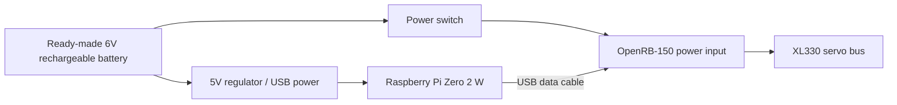
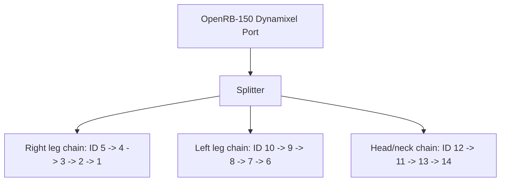

# Microduck — English build guide

[Ordering BOM](BOM.md) · [Fork status and build notes](BUILD.md) · [Original Chinese guide](README.zh-CN.md)

This is Steven's working fork of [AI-FanGe/Microduck-build-tutorial](https://github.com/AI-FanGe/Microduck-build-tutorial), starting from `49678215d0b40529522772a40c06c216390449dd`.

**Selected motors: ROBOTIS Dynamixel XL330-M288-T.** Fourteen are used by the walking controller; the beak is an optional fifteenth. The recommended prototype order is sixteen, including one spare. Unitree J288 servos belong to the separate Dukki project.

**Fork status:** source inspection and desktop checks only; our robot has not been assembled or walked. The upstream release image linked below does not include this fork's startup/cleanup fixes. The purchasing list and electrical notes in [BOM.md](BOM.md) and [BUILD.md](BUILD.md) take precedence over the inherited power/BOM instructions below.

The bundled printable project is [`microduck3D打印.3mf`](microduck3D打印.3mf). Its saved printer is a P1S; select the X1 Carbon profile and regenerate toolpaths before using it. The root MIT licence does not describe every component; see the scope-specific licences discussed in [BUILD.md](BUILD.md).


<p align="center">
  
</p>
<p align="center">
  
</p>
<p align="center">
  
</p>

Microduck is a compact biped robot project. This repository presents one practical hardware and software setup for running an ONNX reinforcement learning walking policy on real Dynamixel XL330 servos.

The project contains two main parts:

- `microduck/`: deployment code for the Raspberry Pi Zero 2 W. It reads the IMU, reads keyboard or gamepad commands, drives Dynamixel servos, and loads the ONNX walking policy.
- `mjlab_microduck/`: reinforcement learning training environment based on MuJoCo/MjLab. It is used to train and export `walk.onnx`.

This README covers the full first-time workflow: hardware, wiring, flashing `microduck.img.xz`, Wi-Fi setup, first SSH login, first run, day-to-day usage, and rebuilding a release image.

## Acknowledgements

Thanks to the open-source projects [microban](https://github.com/Rhoban/microban) and [microduck](https://github.com/pollen-robotics/microduck). This project benefits from their mechanical design, deployment ideas, simulation training work, and real-robot walking pipeline.

## Project Status

The current release image includes:

- Raspberry Pi OS Lite 64-bit.
- Hostname `microduck`.
- Default user `user`.
- Deployment directory `~/microduck`.
- Python virtual environment `~/microduck/.venv`.
- Walking model `~/microduck/src/agents/walk.onnx`.
- Headless gamepad service `microduck-gamepad.service`, so the walking controller can be started from a gamepad after boot.

Current prebuilt image:

- [microduck.img.xz](https://github.com/AI-FanGe/Microduck-build-tutorial/releases/download/image.v1/microduck.img.xz)

SHA256:

```text
096885dc32fb5b1db2ad69ba6bea868d8ab988f2b47c0d884eb63ba0dfdcb5c4
```

## BOM

The following is the main bill of materials for building one Microduck. Prices vary by region, supplier, and quantity, so treat them as estimates.

| Category | Part | Qty | Notes |
| :--- | :--- | :---: | :--- |
| Main controller | Raspberry Pi Zero 2 W | 1 | Runs the control program, Bluetooth gamepad, Wi-Fi, and SSH. |
| Servo controller | ROBOTIS OpenRB-150 | 1 | Connected to the Raspberry Pi over USB. It communicates with the XL330 servo bus. The code first looks for `/dev/serial/by-id/usb-ROBOTIS_OpenRB-150_*`. |
| Servos | Dynamixel XL330-M288-T | 14 | The current walking code uses 14 servos: 10 for the legs and 4 for the head/neck. An optional mouth servo can use ID 15, but the walking policy does not depend on it. |
| Battery | To be specified after bench power tests | 1 | Inherited build used a nominal 6 V pack. Retail XL330 input must stay within 3.7–6.0 V, including full charge and transients. See BUILD.md before purchasing or wiring a pack. |
| Switch | Power switch | 1 | Main power switch for the robot. |
| Storage | 16GB or larger microSD card | 1 | Use a reliable new card. The image expands the filesystem on first boot. |
| IMU | BNO080/BNO085/BNO086 module | 1 | Read over I2C. The code auto-detects common BNO08x addresses. |
| Mechanical parts | 3D-printed parts | 1 set | Use the root `microduck3D打印.3mf` project. The old `microduck/cad/` directory was deleted upstream. PLA is the initial reference material. |
| Screws | M2/M2.5 self-tapping screws | Several | Used for servo mounting, horn mounting, and structural assembly. Keep extras. |
| Bearings/shims | POM shims and steel shims | Several | Low-cost rotational support. |
| Cables | Dynamixel 3-pin cables, JST wires, power connectors | Several | Servo daisy chains, power wiring, and splitters. |
| Setup tools | Dynamixel U2D2 + U2D2 Power Hub | 1 set | Used to configure servo IDs, baud rate, and parameters. One set can be shared across multiple robots. |

Recommended extras:

- One spare XL330, power wires, and Dynamixel cables. Battery and regulator selection remain pending bench measurements.
- JST-EH terminals, crimping tool, heat-shrink tubing, and hot glue.
- A multimeter for checking polarity and battery voltage.

## Servo IDs

The deployment code expects the following ID mapping. Configure every servo with Dynamixel Wizard before the first run.

| ID | Name | Position |
| :---: | :--- | :--- |
| 1 | `right_ankle` | Right ankle |
| 2 | `right_knee` | Right knee |
| 3 | `right_hip_pitch` | Right hip pitch |
| 4 | `right_hip_roll` | Right hip roll |
| 5 | `right_hip_yaw` | Right hip yaw |
| 6 | `left_ankle` | Left ankle |
| 7 | `left_knee` | Left knee |
| 8 | `left_hip_pitch` | Left hip pitch |
| 9 | `left_hip_roll` | Left hip roll |
| 10 | `left_hip_yaw` | Left hip yaw |
| 11 | `head_pitch` | Head pitch |
| 12 | `neck_pitch` | Neck pitch |
| 13 | `head_yaw` | Head yaw |
| 14 | `head_roll` | Head roll |
| 15 | `mouth` | Optional mouth servo, not used by the current walking policy |

Recommended Dynamixel Wizard settings:

- Protocol: `2.0`
- Baud Rate: `1Mbps`
- Return Delay Time: `0`
- PWM Slope: `255`
- Shutdown/protection settings: retain manufacturer protections for commissioning. Diagnose rail droop and verify the supply before changing protection settings; do not disable protection to mask a power problem.

## Wiring

### Power Wiring

**Inherited reference diagram, not our released wiring design.** A nominal 6 V battery label does not ensure a maximum of 6 V. The OpenRB DXL rail is rated for 3 A and must not carry the entire robot's load. See [BUILD.md](BUILD.md) for the regulated-rail and power-distribution work still required.

The upstream power path was:



Checklist:

- Check polarity with a multimeter before powering on.
- This setup uses a ready-made 6V rechargeable battery. It does not require a custom two-cell battery pack, BMS, or 2S charger board.
- OpenRB-150 handles XL330 servo communication. The Raspberry Pi connects to it over USB.
- The Raspberry Pi needs stable 5V power. The servos/OpenRB-150 are powered from the 6V battery side. Grounds must be common. Follow your actual regulator and OpenRB-150 wiring.
- Insulate solder joints with heat-shrink tubing or hot glue to prevent shorts.

### Servo Bus

XL330 servos use a 3-pin daisy-chain bus. The OpenRB-150 output can be split into the right leg, left leg, and head/neck chains.



Notes:

- The physical cable order can follow the mechanical layout, but the servo IDs must match the table above.
- If the bus has communication errors, first check that the OpenRB-150 enumerates correctly, then check battery voltage, ground, cable order, and servo IDs.
- Normally the code automatically selects the OpenRB-150 USB serial port. If not found, it falls back to `/dev/ttyACM0`, `/dev/serial0`, `/dev/ttyAMA0`, or `/dev/ttyS0`.

### IMU Wiring

The BNO08x module uses I2C:

| IMU Pin | Raspberry Pi / Hat |
| :--- | :--- |
| `VIN` / `3V3` | 3.3V, depending on the module label |
| `GND` | GND |
| `SDA` | GPIO2 / I2C SDA |
| `SCL` | GPIO3 / I2C SCL |

The software uses I2C bus `1` by default and auto-detects common BNO08x addresses. The mounting orientation is configured by `IMU_MOUNT_QUAT`, which is already matched to the current walking model.

## Using `microduck.img.xz`

### 1. Verify the Image

After downloading or copying the image, verify it:

```bash
sha256sum microduck.img.xz
```

The result should match the SHA256 published with the image.

### 2. Flash the SD Card

Raspberry Pi Imager is recommended:

1. Insert the microSD card.
2. Open Raspberry Pi Imager.
3. Select `Choose Device` -> `Raspberry Pi Zero 2 W`.
4. Select `Choose OS` -> `Use custom`, then choose `microduck.img.xz`.
5. Select `Choose Storage`, then choose the target microSD card.
6. If asked whether to apply OS customization settings, choose `No`.
7. Click `Write` and wait for writing and verification to complete.

You can also flash from the Linux command line. Be very careful with the device name:

```bash
lsblk
xzcat microduck.img.xz | sudo dd of=/dev/sdX bs=4M status=progress conv=fsync
```

Replace `/dev/sdX` with your SD card device. Do not write to your computer's internal disk.

### 3. Initialize Wi-Fi

Use either method. The Raspberry Pi Zero 2 W only supports 2.4GHz Wi-Fi. Do not use a 5GHz-only network.

#### Method 1: Edit the SD card on a computer

After flashing, unplug and reinsert the SD card. Ubuntu usually mounts two partitions:

- `bootfs`: boot partition, where Wi-Fi can be configured.
- `rootfs`: root filesystem, usually no manual edits are needed.

Edit:

```bash
sudo nano /media/$USER/bootfs/network-config
```

The file looks like this:

```yaml
network:
  version: 2
  ethernets:
    eth0:
      dhcp4: true
      dhcp6: true
      optional: true
  wifis:
    wlan0:
      dhcp4: true
      regulatory-domain: "<YOUR_COUNTRY_CODE>"
      access-points:
        "<YOUR_WIFI_NAME>":
          password: "<YOUR_WIFI_PASSWORD>"
      optional: true
```

Replace:

- `<YOUR_COUNTRY_CODE>`: two-letter country code, such as `CN`, `US`, `GB`, or `FR`.
- `<YOUR_WIFI_NAME>`: Wi-Fi name.
- `<YOUR_WIFI_PASSWORD>`: Wi-Fi password.

Multiple Wi-Fi networks can be configured:

```yaml
      access-points:
        "HomeWifi":
          password: "home-password"
        "PhoneHotspot":
          password: "hotspot-password"
```

Save the file, safely eject the SD card, insert it into the robot, and power on.

#### Method 2: HDMI and keyboard, then nmcli on the Pi

After flashing, insert the SD card into the Pi and connect a mini HDMI display plus a USB keyboard (the Zero needs a USB OTG adapter). The image is Raspberry Pi OS Lite, so there is no desktop — only a terminal login.

The first boot expands the partition. Wait 1 to 3 minutes and do not power off. When the login prompt appears:

```text
username: user
password: password
```

The password is not echoed. Then scan, connect, and enable autoconnect:

```bash
nmcli device wifi list
sudo nmcli device wifi connect "YOUR_WIFI_NAME" password "YOUR_WIFI_PASSWORD"
sudo nmcli con mod "YOUR_WIFI_NAME" wifi.powersave disable
sudo nmcli con mod "YOUR_WIFI_NAME" connection.autoconnect yes
```

Check that it is connected and set to autoconnect:

```bash
nmcli -t -f NAME,TYPE,AUTOCONNECT,DEVICE connection show
hostname -I
```

`AUTOCONNECT` should be `yes`, and the Pi should have an IP address. After that, this Wi-Fi will connect automatically on every boot.

## First Boot

On first boot, the image will:

- Expand the filesystem to the full SD card.
- Regenerate SSH host keys.
- Read `network-config` and join Wi-Fi (method 1). If you use method 2, configure Wi-Fi with `nmcli` after the first boot.
- Start the background gamepad service.

Wait 1 to 3 minutes, then test from your computer:

```bash
ping microduck.local
```

If `.local` does not resolve, check your router's DHCP client list and use the Pi's IP address.

Default login:

```bash
ssh user@microduck.local
```

Default password:

```text
password
```

Change the password after the first login:

```bash
passwd
```

## First Run

### SSH Mode

Log in to the Pi from a computer. Use PowerShell on Windows, or a terminal on Linux / macOS:

```bash
ssh user@microduck.local
```

The default password is `password`. If SSH says `REMOTE HOST IDENTIFICATION HAS CHANGED`, clear the old host key and try again:

```bash
ssh-keygen -R microduck.local
```

After login, place the robot on a stable surface or hold it, then start the control program:

```bash
cd ~/microduck
PYTHONPATH=src .venv/bin/python src/main.py
```

On startup, the program will:

1. Enable servo torque.
2. Smoothly move to the neutral pose.
3. Read keyboard or gamepad input.
4. Load `src/agents/walk.onnx`.

Keyboard controls:

| Key | Action |
| :--- | :--- |
| `v` | Toggle walking |
| Up/down arrows | Forward/backward |
| Left/right arrows | Turn left/right |
| `x` | Zero velocity |
| `i` | Show/hide IMU status |
| `q` | Stop the control loop |

### Remote SSH

After the computer and the robot are on the same 2.4GHz Wi-Fi, run this in Windows PowerShell or a Linux / macOS terminal:

```bash
ssh user@microduck.local
```

Then:

```bash
cd ~/microduck
PYTHONPATH=src .venv/bin/python src/main.py
```

Stop with `q`. If the program is still running, open another SSH session:

```bash
ssh user@microduck.local
cd ~/microduck
PYTHONPATH=src .venv/bin/python src/stop.py
```

Safe shutdown:

```bash
ssh user@microduck.local
sudo shutdown -h now
```

Do not cut power directly. Shut the Pi down first, wait 10 to 15 seconds, then turn off the power switch.

## Gamepad Mode

### Pair a Bluetooth Gamepad

SSH into the Pi, then run:

```bash
bluetoothctl
```

Inside `bluetoothctl`:

```text
power on
agent on
scan on
pair XX:XX:XX:XX:XX:XX
trust XX:XX:XX:XX:XX:XX
connect XX:XX:XX:XX:XX:XX
scan off
quit
```

Replace `XX:XX:XX:XX:XX:XX` with the detected controller MAC address.

### Headless Operation

The image already enables the headless gamepad service. After boot:

| Action | Function |
| :--- | :--- |
| Hold `START` for 2 seconds | Start the control loop |
| `A` | Toggle walking |
| Left stick | Forward/backward and lateral velocity |
| Right stick left/right | Turning |
| `B` | Stop the control loop |
| Hold both triggers for 2 seconds | Safe shutdown |

When the gamepad is connected, the service disables Wi-Fi to improve 2.4GHz Bluetooth stability. Turn off the controller when you need SSH; Wi-Fi will be restored automatically.

## Common Commands

Run these from the `microduck/` directory on your development computer:

| Command | Description |
| :--- | :--- |
| `make sync` | Sync local deployment code to `~/microduck` on the Pi. |
| `make setup` | Sync code and run `uv sync --frozen` on the Pi. Use after dependency changes. |
| `make run` | Sync and start the control loop. |
| `make stop` | Stop the control loop. |
| `make shutdown` | Safely shut down the Pi. |
| `make imu` | Print IMU/gyro data. |
| `make voltage` | Read servo voltage. |
| `make voltage ID=2` | Read voltage from a specific servo. |
| `make gamepad-headless-enable` | Install and enable the headless gamepad service. |
| `make gamepad-headless-disable` | Disable the headless gamepad service. |

## Updating the Model

The ONNX model exported from `mjlab_microduck/` should be placed at:

```bash
microduck/src/agents/walk.onnx
```

Then sync:

```bash
cd microduck
make sync
```

The next run will load the new `walk.onnx`.

## Rebuilding a Release Image

After the Pi system, dependencies, services, and model have been tested, the SD card can be turned into a new `microduck.img.xz`.

Recommended workflow:

1. Test `make run` or headless gamepad mode on the real robot.
2. Shut down the Pi and insert the SD card into your computer.
3. Clone the full card to a local `.img` file.
4. Clean sensitive information only inside the cloned image:
   - Wi-Fi credentials.
   - SSH host keys.
   - User SSH keys.
   - `/etc/machine-id`.
   - cloud-init state.
   - shell history, logs, and apt cache.
5. Reset `bootfs/network-config` to placeholder values.
6. Verify that `~/microduck/src/agents/walk.onnx`, `.venv`, and `microduck-gamepad.service` exist.
7. Use PiShrink to create `microduck.img.xz`.
8. Compute SHA256 and record the checksum in the README or Release notes.

Detailed steps are in:

```bash
microduck/docs/dev/clone_sd.md  # Deleted upstream; instructions are not available in this checkout.
```

## Directory Layout

```text
.
├── README.md
├── microduck/
│   ├── Makefile
│   ├── src/
│   │   ├── main.py
│   │   ├── scheduler.py
│   │   ├── robot_controller.py
│   │   ├── imu_reader.py
│   │   ├── agents/walk.onnx
│   │   └── moves/walk.py
│   ├── systemd/
│   └── docs/
└── mjlab_microduck/
    ├── src/mjlab_microduck/
    └── logs/
```

## Troubleshooting

### `microduck.local` Cannot Be Found

Wait 1 to 3 minutes first. If it still cannot be found:

- Make sure the Wi-Fi is 2.4GHz.
- Make sure the YAML indentation in `network-config` is unchanged (method 1).
- If you used method 2, run `nmcli device wifi list` and `hostname -I` on the Pi to confirm it joined 2.4GHz Wi-Fi and has an IP.
- Check the Pi's IP address in your router.
- Login with `ssh user@<IP>`.

### SSH Says Host Key Changed

The release image regenerates SSH host keys on first boot. If your computer previously connected to another card, clear the local entry:

```bash
ssh-keygen -R microduck.local
ssh-keygen -R <IP>
```

### Servos Do Not Move or Communication Fails

Check:

- Battery voltage.
- OpenRB-150, servo bus, Raspberry Pi power, and common ground.
- Servo IDs match the table above.
- Dynamixel baud rate is 1Mbps.
- OpenRB-150 USB serial port is detected.
- Cable order, splitters, and connector direction.

### SSH Disconnects When the Gamepad Connects

This is expected in headless mode. The service disables Wi-Fi when the gamepad is connected to improve Bluetooth stability. Turn off the controller and Wi-Fi will be restored.

### The Robot Falls Immediately

Hold the robot first, then check:

- Left/right leg servo IDs are not swapped.
- Knee offsets match the physical assembly.
- IMU mounting orientation is correct.
- `walk.onnx` matches the current hardware.

## Safety Notes

- Hold the robot during the first run.
- Do not test near the edge of a table.
- Do not run for a long time on low battery.
- For routine shutdown, use `make shutdown` or the gamepad shutdown gesture before disconnecting power. For uncontrolled motion or an electrical fault, isolate motor power immediately.
- Before charging or powering on, check for shorts, polarity, and insulation.
